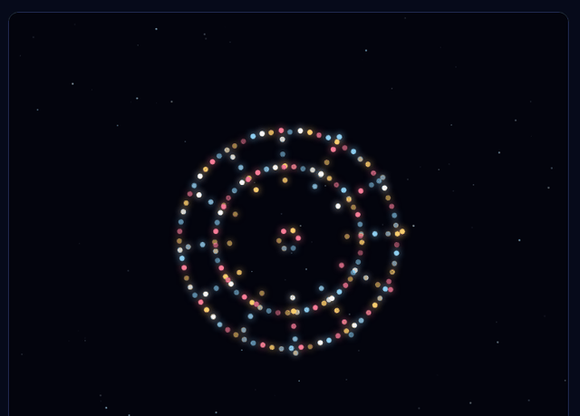
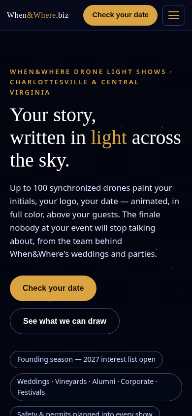
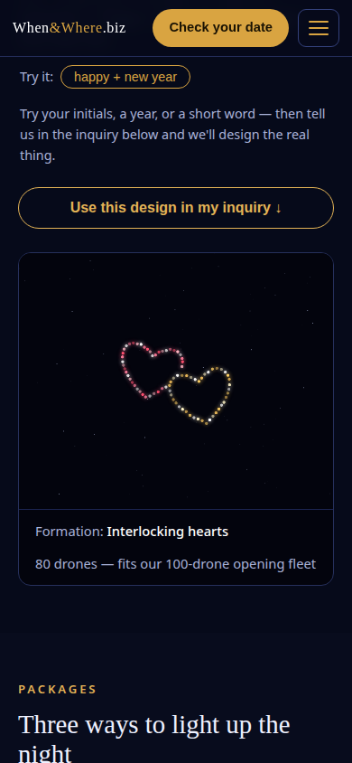
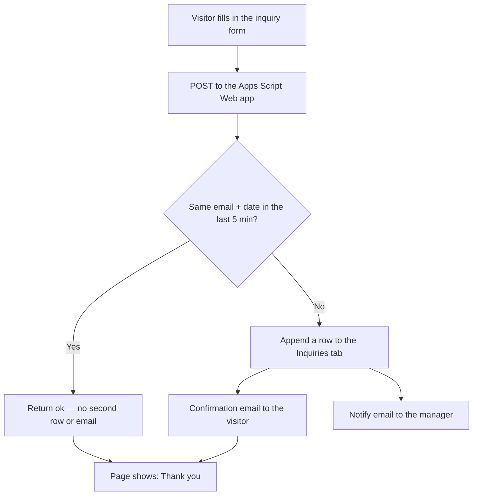

# When&Where Drone Light Shows

Custom drone light shows for weddings, vineyard celebrations, alumni
weekends, corporate events, and festivals across Charlottesville and
Central Virginia. Visitors register interest for the 2027 founding season
through an inquiry form, and can preview formations in an interactive
Formation Studio that draws each design with the drone count it actually
needs.

**Live site:** <https://enonymous1.github.io/whenwhere-drone-light-shows/>
— GitHub Pages, deployed from this repo (see [Deployment](#deployment));
the latest deploy went green.

## Description

A single static page (`index.html`, ~32 KB) plus `style.css` (~13 KB),
`studio.js` (~38 KB, the page's JavaScript), `geometry.js` (~29 KB,
the formation geometry — see below) and `config.js` (~3 KB, the
launch settings), no framework, no build step to view it) with:

- **Hero + six occasion cards** — weddings, vineyards & wineries,
  corporate, festivals, alumni, proposals & private estates.
- **Formation Studio** — an interactive canvas preview. Tap a design and
  the fleet assembles it: interlocking hearts, wedding rings, a wine
  glass, a starburst, a grand finale, or your own words (initials, a year,
  a short word). The word box has a clickable "happy + new year" example
  pill (try the `+` split with no typing) and a ↺ reset back to LOVE;
  clicking the already-active "Your words" button resets to LOVE too.
  Every design is sized to the real fleet — see
  [Fleet sizing](#fleet-sizing).
- **Three packages** — The Moment, The Signature Show, Show + Party (with
  DJ & MC), plus how-it-works steps, a drones-vs-fireworks comparison, and
  an FAQ (FAA Part 107 licensed pilots, insured operations).
- **Inquiry form** — saves to a private Sheet and emails you through an
  Apps Script backend (see
  [Connecting the inquiry form](#connecting-the-inquiry-form-apps-script)),
  the same setup as the main site; the endpoint is connected, so the
  live form works end to end. With no endpoint configured it falls back
  to **demo mode**: submitting builds the inquiry to copy or download,
  and the page says so.


*The Formation Studio assembling the interlocking hearts — 80 drones,
two tones, woven over/under at each crossing.*

### Fleet sizing

Opening fleet is **100 drones**; larger shows need extra lead time to
secure additional units. The studio caption says so per design.

| Design | Drones | Note |
|---|---|---|
| Interlocking hearts | 80 | fits the opening fleet |
| Wedding rings | 100 | uses the full opening fleet |
| Wine glass | 60 | fits the opening fleet |
| Your words (initials / dates) | split by stroke length, 50–100 per moment | fits the opening fleet — + splits a message into separate moments (max 6) |
| Starburst | 200 | larger show — extra lead time |
| Grand finale (twin rings + 12 radiating spikes) | 240 | larger show — extra lead time |

The hero says "Up to 100 synchronized drones", the packages carry fleet
lines (Moment: 50–100 drones; Signature: up to 100 per scene, 200+
finales with extra lead time), and the "How far ahead" FAQ notes that
200+ finales need the earliest possible word.





*Three formations as drawn in the studio: interlocking hearts (rose +
gold, woven), the grand finale (twin rings + 12 spikes, slowly rotating),
and your words (LOVE).*

Word legibility is measured, not assumed: the minimum dots per letter and
per word are recorded in [docs/readability-floor.md](docs/readability-floor.md). To play with the settings live, serve the repo
over HTTP and open [tools/readability-lab.html](tools/readability-lab.html) —
it re-renders every letter from the real pipeline as you move the controls.

## Screenshots

Captured from the page in dark mode (the page follows the OS — the
light rendering is the same layout in warm ivory). Served over HTTP
so the fonts load.

Desktop — 1920×1080, the most common desktop resolution:


Mobile — 390×844, a typical phone viewport. The nav collapses to a
hamburger, the hero stacks, and the buttons go full-width:



The Formation Studio on a small screen — the same 390×844 viewport,
scrolled to the canvas. The hearts read clearly at phone width, and
the caption still names the formation and its drone count:



These are headless captures at a phone viewport, not photos of a
physical phone — a real-phone screenshot of the studio is still the
gold standard (see [Still to capture](#still-to-capture-needs-real-shows-cannot-be-faked)).

## Prerequisites

To **view** the page you need nothing but a browser. To **rebuild** it
from the source, or run the tests, you need:

| Tool | Needed for | Version |
|---|---|---|
| Python 3 | Running the build script | 3.9+ |
| Pillow (`pip install Pillow`) | Extracting + resizing the photos in the build | any recent |
| Node.js | The build's JS syntax check (`node --check`) and the smoke test | 22+ |
| Chrome or Chromium | The smoke test and the assembly-GIF capture | any recent |

Node and Chrome are optional: without Node the build prints a warning
and skips the JS syntax check; without Chrome the smoke test cannot run.

## Installation

```bash
git clone https://github.com/enonymous1/whenwhere-drone-light-shows.git
cd whenwhere-drone-light-shows
pip install Pillow
```

There are no other dependencies — the page is plain HTML, CSS, and
JavaScript, and its only external requests are Google Fonts (Marcellus +
Jost) and, once connected, the Apps Script backend.

## Local Development

### Preview

Open `index.html` in a browser, or serve the folder so relative paths
resolve exactly as they will on Pages:

```bash
python3 -m http.server 8000
# open http://localhost:8000
```

### Editing the page

**`index.html` is the source of truth — edit it by hand.** The build
script (`tools/build.py`) only optimizes the photos and checks the
result: it downsizes any referenced photo over spec (hero 1248px wide,
occasion cards 900px; JPEG quality 80, progressive), syncs each
`` tag's width and height to the file on disk, and validates the
page. To swap a photo, drop the replacement into `assets/` under the
same name and rebuild:

```bash
python3 tools/build.py
# index.html written: ~42,100 chars
# node --check: OK
```

Check the committed page without rebuilding it, and see the usage:

```bash
python3 tools/build.py --check   # exit 0 if index.html matches a fresh build, 1 if stale
python3 tools/build.py --help
```

### Type-checking the page scripts

`config.js` + `geometry.js` + `studio.js` carry JSDoc types
(`// @ts-check` at the top of each file). The shapes live in
`types.d.ts` — the `.js` files reference them via JSDoc `import()`
types, so there is one definition of each type. The checker verifies
them and emits nothing — the `.js` files are the shipped code, and
`types.d.ts` is never loaded by the browser. Run it after editing any
of the three `.js` files (or `types.d.ts`):

```bash
npm ci            # once, to install TypeScript (dev-only)
npx tsc --noEmit  # exit 0 when the types are clean
```

It is deliberately not strict (see `tsconfig.json`): it catches shape
mistakes in the geometry + config, not every `getElementById` null.
The check also runs in CI, alongside the smoke + geometry tests.

The deployed page carries a `<!-- whenwhere-drone-light-shows v1.5.1 -->`
comment at the top so it can be traced to a build; releases are listed
in [CHANGELOG.md](CHANGELOG.md). To release a new version, bump that
comment in `index.html` and add a section to the changelog.

The page's JavaScript lives in `studio.js` — the Formation Studio
renderer, the inquiry form, the package shortcuts, and the mobile
nav — with the launch settings in `config.js` (loaded before it).
The formation geometry itself lives in `geometry.js`, loaded between
`config.js` and `studio.js`: a `WhenWhereGeometry.create(W, H,
palettes)` factory that returns the formation functions, the word
renderer, and TUNING bound to a canvas of W×H (the drone page passes
900×732). `studio.js` calls it once and aliases the functions it uses;
the same file is what the workbench will load, so the geometry is
never duplicated. Edit them there, never inline: `index.html` carries
no inline executable script (only the JSON-LD data block), and the
build fails if one appears, because the page's Content Security Policy
allows `script-src 'self'` only.
The page's CSS lives in `style.css`, linked from `index.html` — edit
it there, never inline (the page still has a few inline `style=""`
attributes on individual elements, so `style-src` keeps
`'unsafe-inline'` alongside `'self'`). The policy also covers the
Google Fonts stylesheet (`style-src`), the font files (`font-src`),
and the form's POST (`connect-src` for the Apps Script endpoints).
The pure geometry functions are exposed as
`window.WHENWHERE.geometry` and covered by the geometry unit tests.

The build fails loudly (non-zero exit) on a missing or corrupt photo,
and it validates the result: it runs `config.js`, `geometry.js`, and
`studio.js` through `node --check` when Node is available, asserts the
load order (config → geometry → studio), and asserts the fleet
counts are present in `config.js`. A rebuild with nothing changed is a no-op. Run it from any
directory — paths resolve from the script's own location.

### Editing the site content (Google Sheets)

The page's text and photos are editable from a Google Sheet — no code
changes and no redeploy for copy edits. The page reads the Sheet
(published as CSV) and overrides the matching text and images; the
text baked into `index.html` stays as the fallback, so the page is
unchanged if the Sheet is unreachable.

**How it works:** every editable bit of copy is tagged in the HTML
with `data-content="key"` (text) or `data-content-img="key"` (an
``). A loader at the end of `studio.js` fetches the content and
applies it. The content source is `CONTENT_CSV_URL` in `config.js`;
when it is blank the page reads `content.json` beside `index.html`
instead. Blank cells are ignored, so a half-filled Sheet never wipes
text. The page's Content Security Policy allows the content fetch:
`connect-src` includes `'self'` (for `content.json`),
`https://docs.google.com` (for the published Sheet CSV), and
`https://*.googleusercontent.com` — the published Sheet URL redirects
to a per-document `doc-*-sheets.googleusercontent.com` host, and the
fetch is blocked without that wildcard (the page then silently falls
back to `content.json`).

**The Sheet** has four columns — `key | text | image | alt` — one row
per item. Text rows fill in `text`; image rows fill in `image` (a
filename in `assets/`, e.g. `assets/weddings.jpg`, or a full URL) and
`alt` (the accessibility description). Image size is set by the
page's CSS, not the Sheet. A few rows keep markup in `text` — the
hero headline and a couple of labels — and those must keep their
`<span>` / `<br />` / `<a>` tags when edited; everything else is
plain text. `docs/content.csv` is the current Sheet contents in CSV
form (133 rows) — paste it into a new Sheet to start. Note: an
external image URL (as opposed to a repo filename) also needs adding
to the CSP's `img-src` in `index.html`, which currently allows
`'self'` and `data:` only.

**To connect a Sheet:**

1. Create a new Google Sheet (one per site) and paste in
   `docs/content.csv` — File → Import → Upload, or paste the rows.
2. File → Share → Publish to web → choose the Sheet, format CSV,
   Publish. Copy the link.
3. Paste the link as `CONTENT_CSV_URL` in `config.js` and push once.
   After that, editing the Sheet updates the page with no redeploy
   (the page fetches with `no-store`, so edits show on the next load).

**What is and isn't in the Sheet:** the marketing copy (hero,
occasions, studio intro, packages, how it works, why drones, FAQ,
form labels, footer) and the seven photos. Not in it: the nav labels,
the studio's shape buttons and drone counts (those are driven by
`FLEET` in `config.js`), the submit button and form note (both set by
the form's mode in JS), the send-failure result panel, the validation
messages, and the checkbox/radio option labels (they contain the
inputs, so overriding their text would wipe the control). To add a new
editable bit later, tag the element with `data-content="new-key"` (or
`data-content-img`), add the row to the Sheet and to `content.json`,
and the loader picks it up. Swapping the back-end later (for example
to a CMS that emits the same `key → {text, image, alt}` map) only
means changing how the map is fetched — the override mechanism stays
the same.

### Tests

```bash
node tests/smoke.mjs            # loads the page in headless Chrome and
                                # asserts every formation's drone count,
                                # the button labels, and no JS errors
node tests/geometry.mjs         # unit tests for the pure geometry
                                # (resample, resampleRuns, heartPair,
                                # thinUniform, wordPoints, skeletonize,
                                # finalePts, allocateCounts,
                                # separatePoints, splitSlides) — 52 assertions on
                                # window.WHENWHERE.geometry, no JS errors
node --check tests/smoke.mjs    # syntax-check the tests themselves
node --check tests/geometry.mjs
```

Both tests need Chrome (set `CHROME_PATH` if it is not on the
usual paths). They run against the built `index.html` in this folder, so
rebuild first if you changed the build script. In CI the workflow
passes the setup-chrome binary explicitly (`CHROME_PATH` from the
setup-chrome step's `chrome-path` output) — the runner's preinstalled
Chrome failed to start under the test's flags in Nov 2026, so the tests
never guess which Chrome to use. The geometry test is mutation-checked:
it fails on a word count of 20 per character instead of 25, and on a
resampleRuns that interpolates across a break.

### Regenerating the screenshots and GIF

The images in `docs/screenshots/` are captured from the built page with
headless Chrome (see `tests/capture-assembly.mjs` for the GIF — it drives
the real browser over the DevTools Protocol because the animation is
`requestAnimationFrame`-driven and virtual time cannot fast-forward it):

```bash
node tests/capture-assembly.mjs heart /tmp/ww-gif/frames
python3 - <<'EOF'
from PIL import Image
import pathlib
frames = sorted(pathlib.Path('/tmp/ww-gif/frames').glob('frame-*.png'))
imgs = [Image.open(f).convert('RGB').resize((640, 459), Image.LANCZOS) for f in frames]
imgs[0].save('docs/screenshots/formation-assembly.gif', save_all=True,
             append_images=imgs[1:], duration=200, loop=0, optimize=True)
EOF
```

The finale GIF is the same recipe, with a settle delay so the frames
show the settled formation's rotation instead of the assembly (the
finale takes ~2s to assemble; it rotates at 0.15 rad/s, a full turn
in ~42s, so 3s of frames shows the 12 spikes sweep ~26°):

```bash
node tests/capture-assembly.mjs finale /tmp/ww-gif/finale-frames 3000
python3 - <<'EOF'
from PIL import Image
import pathlib
frames = sorted(pathlib.Path('/tmp/ww-gif/finale-frames').glob('frame-*.png'))
imgs = [Image.open(f).convert('RGB').resize((640, 459), Image.LANCZOS) for f in frames]
imgs[0].save('docs/screenshots/formation-finale.gif', save_all=True,
             append_images=imgs[1:], duration=200, loop=0, optimize=True)
EOF
```

Settled-formation stills are plain headless screenshots with
`--force-prefers-reduced-motion` (which snaps the fleet to its final
positions), cropped to the stage. The hero still is a plain headless
screenshot of the top of the page at 1920×1080, served over a local
server so the fonts load. The mobile hero and mobile studio stills are
the same recipe at 390×844 (a typical phone viewport), with the studio
shot scrolled to the canvas so the formation is in frame (capture
script: `~/workspace/.scratch/ww-capture-drone-responsive.mjs`, usage
`node ww-capture-drone-responsive.mjs <page-url> <dark|light> <width>
<height> <hero|studio> <out.png>`). The hero background is the animated
starfield canvas now (not the old hero photo), so it draws the same
over `file://` or HTTP — the photo is kept in `assets/` only as the
social-preview (`og:image`) image. Capture it in dark mode (the page follows the OS;
the README's hero is the dark rendering, which is where the themed
scrollbar shows).

### Configuration — the two things to set before launch

Everything launch-specific lives in one place, `WHENWHERE_CONFIG`, in
`config.js` (loaded before `studio.js`, which reads it and fails loudly
if it is missing):

```js
window.WHENWHERE_CONFIG = {
  // the deployed Apps Script Web app URL — set in config.js
  INQUIRY_ENDPOINT: '<the deployed Apps Script Web app URL>'
  // ... plus FLEET, COLORS, PALETTES, COOLDOWN_MS, INQUIRY_KEY,
  // DATE_MIN_DAYS_AHEAD, DATE_MIN_FLOOR — see config.js
};
```

The endpoint is connected: the live form saves to the private Sheet and
emails you. If the Apps Script deployment is ever replaced, paste the
new URL as `INQUIRY_ENDPOINT` in `config.js` and push.

- **No business inbox is set up yet**, so the page lists no email address:
  the brand and footer link to the main site
  (`https://enonymous1.github.io/whenwhere-biz-main-site/`), and
  inquiries arrive through the connected Apps Script backend below. If a real
  business inbox is added later, that is when a contact email belongs
  here.
- **Fleet counts** are the single source of truth in `FLEET` (in
  `config.js`): the count tags on the formation buttons are filled
  from it at load, so the labels can never drift from the real counts.

## Deployment

Hosted on GitHub Pages via GitHub Actions — free, fast, versioned in
git, and the form posts to a free Apps Script Web app (no server to run).
The workflow (`.github/workflows/pages.yml`) rebuilds `index.html` from
source, runs the smoke test, and deploys the freshly built site on every
push to `main`. The live page is always current with the repo: you never
deploy by hand, and you never have to remember to rebuild before
pushing — the workflow does both.

**One-time setup:**

1. Upload this folder's contents (including `.github/` and `tools/`) to
   the root of a public repo, e.g. `enonymous1/whenwhere-drone-light-shows`.
2. Repo → **Settings → Pages → Build and deployment → Source: GitHub
   Actions** → Save. (Not "Deploy from a branch" — that would publish
   the committed file and skip the build.)
3. Push to `main`. Watch the run under the repo's **Actions** tab; it
   takes ~1–2 minutes. The live URL is
   `https://enonymous1.github.io/whenwhere-drone-light-shows/`.

**How it stays current:** any push to `main` — a copy change, a fleet
count, a new photo, a build-script fix — triggers a fresh build, the
smoke test, and a deploy. Pull requests run the build and the smoke test
but do not deploy, and fail if the committed `index.html` is stale
(rebuild locally and commit it). To redeploy without a code change:
**Actions → Deploy to GitHub Pages → Run workflow**.

When the full site is ready, move these files under
`whenwhere.biz/drone-light-shows/` — the canonical URL and `og:image` in
`index.html` already point there. Note they point at `whenwhere.biz`
today, so social cards will not resolve until the move (the page itself
works fine on Pages in the meantime).

## Connecting the inquiry form (Apps Script)

Same setup as the main site — and it is connected: `INQUIRY_ENDPOINT`
is set in `config.js`, so the live form saves to the private Sheet
and emails you. The steps below are the record of how it was connected
(and how to redo it if the deployment is ever replaced). With no
endpoint configured the form falls back to **demo mode**: submitting
shows the inquiry to copy/download and says so ("Demo mode: no inquiry
endpoint is connected yet…"). To connect (or reconnect):

1. Create a new **private** Google Sheet, e.g. "When&Where Drone
   Inquiries". This is where inquiries land — keep it private, it holds
   visitor contact details.
2. In that Sheet: **Extensions → Apps Script**, delete the default
   `Code.gs` contents, and paste in `apps-script/Code.gs` from
   this repo.
3. In the script, change the one setting at the top, `NOTIFY_EMAIL`,
   to the personal email you want notifications sent to. It accepts
   several addresses separated by commas.
4. **Deploy → New deployment → Web app** — Execute as: Me, Who has
   access: Anyone. Copy the Web app URL.
5. In `config.js`, find `WHENWHERE_CONFIG` and paste the URL as
   `INQUIRY_ENDPOINT`.
6. Rebuild (`python3 tools/build.py`) and push to `main` — the workflow
   rebuilds, smoke-tests, and redeploys automatically — then submit a
   test inquiry from the live page. It should appear as a row in the
   Sheet's **Inquiries** tab within seconds, under the header row in
   row 1 (the script writes the headers when the tab is still empty;
   if the sheet already has rows, insert a row at the top for the
   headers instead of typing over row 1), and the notification email
   ("New drone light show inquiry — …") should arrive with all 12
   fields. The page shows a short "Thank you" on success — the full
   details only appear in demo mode or if the send fails, so the
   visitor can copy them.

From then on the form saves straight to the private Sheet and emails
you — reply from that personal Gmail. If you change the script after
deploying, **Deploy → Manage deployments → edit the deployment and
pick the new version**, or the live URL keeps running the old code.

How one inquiry travels:



The full visitor + manager workflow is in
[docs/inquiry-pipeline.md](docs/inquiry-pipeline.md).

**Still to do:** submit one test inquiry from the live page (and
delete the test row from the Sheet afterwards) — the endpoint is wired,
but no live submission has been confirmed yet.

Spam guard: the script drops a repeat of the same email + event date
inside 5 minutes (same "ok" back, no second row or email), and the
form itself won't re-send from the same browser inside 5 minutes
either. A different event date, or waiting it out, goes through.

## Before launch checklist

- [ ] Test one live submission from the live page (the form is
      connected — see above) and delete the test row afterwards.
      Inquiries arrive through the Apps Script backend — no business
      inbox exists yet, so the page lists no email address.
- [ ] Check the canonical / `og:image` URLs still point at the final home
      once the page moves to `whenwhere.biz` (they already say
      `whenwhere.biz/drone-light-shows/`).
- [ ] Swap the illustrative photos for real founding-season show photos
      when you have them (the honest disclaimer line under the occasion
      cards stays until then).
- [ ] Add analytics if you want to measure which package or occasion
      drives inquiries.

## Open items

Moved here from the Nov 12 staff review (`REVIEW.md`, deleted
2026-11-18 — its fixes are in git history; only the still-open items
survive below). Each was re-checked against the shipped page before
moving it. The five small fixes (canvas guard, clipboard fallback,
clear-word behaviour, UTC date minimum, `currentName` guard) were
implemented 2026-11-18 and removed from this list — clearing the
custom-word input now clears the sky to 0 drones. The Documentation
items (form IIFE header comment, `setFormation` comment, JSDoc on the
four geometry functions) were done 2026-11-18 and removed from this list.
The version + changelog item was done 2026-11-18 and removed from this list.
The `index.html` as source of truth item was done 2026-11-18 and removed from this list.
The `studio.js` split was done 2026-11-18 and removed from this list.
The unit tests were done 2026-11-18 and removed from this list —
probing showed the hearts cross once in the current layout, not twice
as the review guessed, so the test asserts the one observed crossing
(one gap in the left heart, right heart continuous) rather than ≥ 2
crossings.

### Longer term

- **Performance, when it matters:** `draw()` sets `shadowBlur = 12` per
  drone per frame — replace with a pre-rendered glow sprite when the
  page gets real mobile traffic (it changes the glow's look, so not
  casually). Add `srcset` with a 480 w variant when the photos are
  replaced with real show photos.
- **Magic numbers:** if the studio grows a sixth shape, extract a
  `GEOMETRY` object with named fields (heart size, centers, tilt, gap
  radius, crossing thresholds, spin, pulse).
- **Formation Workbench:** the studio's geometry already lives in
  `geometry.js`, shared with the unlisted workbench at
  [`workbench/index.html`](workbench/index.html) — a design tool for
  customer meetings (formation picker, word style controls that only
  show when words are active, palette picker, "Copy this design"
  summary). It also exports the formation on screen as a Skybrush
  `.skyc` show file — a takeoff from a ground grid, the held shape,
  and a landing back to the grid (drone spacing, takeoff spacing,
  altitude, and hold-time settings; the picture's width follows from
  the drone spacing, and the takeoff grid has its own spacing so the
  ground zone can stay tight; the stats line shows the actual lowest
  and highest drone and the grid footprint, and warns if the highest
  drone would exceed the ceiling, or the closest pair would fall under
  the minimum distance). The limits live in one place — `rules.js` at
  the repo root, the FAA Part 107 baseline (120m ceiling, 0.5m takeoff
  floor, 1.5m minimum distance) plus an optional per-venue override,
  so a venue with a waiver only edits that file and the preview, the
  warnings, and the export all move together. The export declares its
  safety thresholds in the file — the ceiling in force, the minimum
  distance between drones, and a navigation floor at the lowest drone
  so the ground grid isn't flagged as too close. The same formation
  also exports as a zipped set of per-drone CSVs (Time, x, y, z, R, G,
  B every second, the universal exchange format) and as a Google Earth
  .kmz (one flight path per drone, anchored to the venue's latitude
  and longitude and the show's orientation, which are saved in the
  browser). The studio preview
  shows the same rules as a compliance line under the canvas: the
  formation as a real show at 3m spacing and 40m centre altitude, with
  its highest drone and closest pair, and whether it sits inside the
  ceiling in force. The takeoff and landing
  are straight lines, 30s each; run Skybrush Live's show adaptation
  for a layered takeoff on a real flight. The export sits in the right
  column under the preview. It is unlisted on purpose:
  no link from the site, `<meta name="robots" content="noindex">`,
  opened by bookmark or pasted link. The sequencer is the next
  phase; see the proposal in
  `~/workspace/your_files/whenwhere-formation-workbench-proposal.md`.

### Still to capture (needs real shows, cannot be faked)

- **A real phone screenshot** of the studio on a small screen. A
  headless capture at a 390×844 phone viewport now exists
  (`docs/screenshots/studio-mobile.png`, in the Screenshots section)
  — a photo of a physical phone is still the gold standard.
- **A 15-second screen recording** of a full show night, if one exists
  from a rehearsal — that belongs in the gallery/showcase, not the
  hero (the hero is the starfield canvas now).

## Project structure

```text
whenwhere-drone-light-shows/
├── .github/
│   └── workflows/
│       └── pages.yml           # build + type-check + smoke test + geometry tests + deploy on push to main
├── apps-script/
│   └── Code.gs                 # Apps Script doPost for the inquiry Sheet
├── index.html                  # the page (source of truth — see Local Development)
├── style.css                   # the page's CSS, linked from index.html
├── config.js                   # launch settings (endpoint, fleet, palettes, cooldown, dates, content CSV)
├── geometry.js                 # formation geometry (createGeometry factory: shapes, words, TUNING)
├── studio.js                   # page JavaScript (studio renderer, form, shortcuts, nav, content loader)
├── types.d.ts                  # shared types (the canonical typedefs; referenced by config.js + geometry.js + studio.js)
├── tsconfig.json               # TypeScript check settings for config.js + geometry.js + studio.js + types.d.ts (no emit)
├── package.json                # dev-only: TypeScript for the type check
├── package-lock.json           # pins the TypeScript version
├── content.json                # the page content, local fallback for the Sheet
├── tools/
│   ├── build.py                # image optimization + checks (index.html is the source of truth)
│   └── readability-lab.html    # word-readability diagnostic (drives the live page)
├── workbench/
│   ├── index.html              # Formation Workbench (unlisted, noindex) — design tool for customer meetings
│   ├── workbench.js            # workbench renderer + controls (loads ../config.js + ../geometry.js)
│   ├── skyc.js                 # Skybrush .skyc export: 2D→3D mapping, show.json builder, ledctrl encoder, ZIP writer
│   └── style.css               # workbench styles (Night & Gold, system-aware; the canvas stays a dark sky)
├── assets/                     # photos (social-preview hero + 6 occasion cards, optimized JPEG)
│   ├── hero.jpg                # og:image only — the hero is the starfield canvas (1248×832, 161 KB)
│   └── weddings.jpg … proposals.jpg   # occasion cards (900 px wide, ~30–104 KB)
├── docs/
│   ├── content.csv             # the Sheet contents (key | text | image | alt), 133 rows
│   ├── content-editing.md      # how to edit the site's text + photos in the Sheet
│   ├── inquiry-pipeline.md     # inquiry-to-show workflow, visitor + manager views
│   ├── readability-floor.md    # measured minimum dots per letter/word (25px floor)
│   ├── readability-floor/      # probe renders behind that table
│   └── screenshots/            # hero (desktop + mobile), mobile studio, formation stills, assembly + finale GIFs (for this README)
├── tests/
│   ├── smoke.mjs               # CDP smoke test: formation counts, labels, JS errors
│   ├── workbench-smoke.mjs     # CDP smoke test for the workbench: formations, words, palette, design summary, Skybrush export
│   ├── geometry.mjs            # CDP unit tests: pure geometry, 52 assertions
│   └── capture-assembly.mjs    # CDP frame capture for the assembly GIF
├── CHANGELOG.md                # one line per shipped change, dated
├── README.md
└── LICENSE                     # © 2026 When&Where.biz, all rights reserved
```

## License

© 2026 When&Where.biz — All rights reserved. See `LICENSE`.
