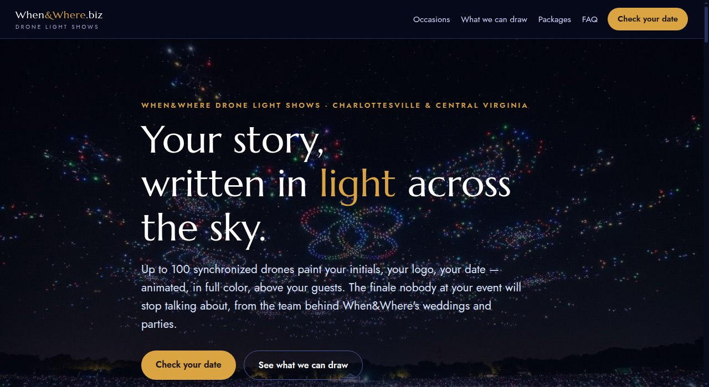
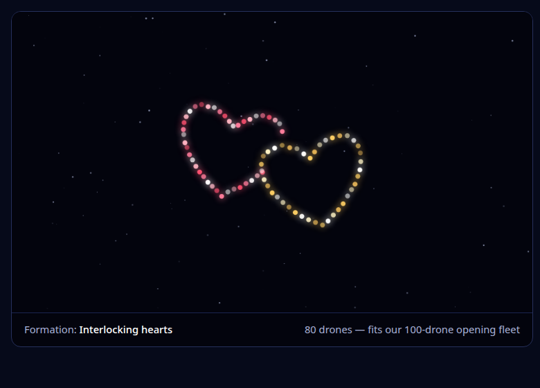
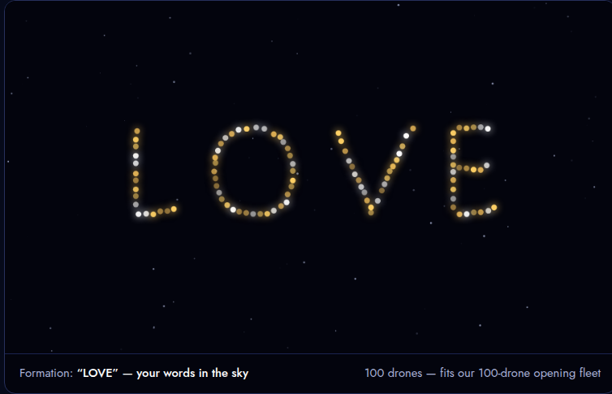

# WhenWhere Drone Light Shows



Custom drone light shows for weddings, vineyard celebrations, alumni
weekends, corporate events, and festivals across Charlottesville and
Central Virginia. Visitors register interest for the 2027 founding season
through an inquiry form, and can preview formations in an interactive
Formation Studio that draws each design with the drone count it actually
needs.

**Live site:** <https://enonymous1.github.io/whenwhere-drone-light-shows/>
— GitHub Pages, deployed from this repo (see [Deployment](#deployment));
the latest deploy went green.

## Description

A single static page (`index.html`, ~71 KB, no framework, no build step
to view it) with:

- **Hero + six occasion cards** — weddings, vineyards & wineries,
  corporate, festivals, alumni, proposals & private estates.
- **Formation Studio** — an interactive canvas preview. Tap a design and
  the fleet assembles it: interlocking hearts, wedding rings, a wine
  glass, a starburst, a grand finale, or your own words (initials, a year,
  a short word). Every design is sized to the real fleet — see
  [Fleet sizing](#fleet-sizing).
- **Three packages** — The Moment, The Signature Show, Show + Party (with
  DJ & MC), plus how-it-works steps, a drones-vs-fireworks comparison, and
  an FAQ (FAA Part 107 licensed pilots, insured operations).
- **Inquiry form** — saves to a private Sheet and emails you through an
  Apps Script backend (see
  [Connecting the inquiry form](#connecting-the-inquiry-form-apps-script)),
  the same setup as the main site; the endpoint is connected, so the
  live form works end to end. With no endpoint configured it falls back
  to **demo mode**: submitting builds the inquiry to copy or download,
  and the page says so.


*The Formation Studio assembling the interlocking hearts — 80 drones,
two tones, woven over/under at each crossing.*

### Fleet sizing

Opening fleet is **100 drones**; larger shows need extra lead time to
secure additional units. The studio caption says so per design.

| Design | Drones | Note |
|---|---|---|
| Interlocking hearts | 80 | fits the opening fleet |
| Wedding rings | 100 | uses the full opening fleet |
| Wine glass | 60 | fits the opening fleet |
| Your words (initials / dates) | ~25 per character, 50–100 | fits the opening fleet |
| Starburst | 200 | larger show — extra lead time |
| Grand finale (twin rings + 12 radiating spikes) | 240 | larger show — extra lead time |

The hero says "Up to 100 synchronized drones", the packages carry fleet
lines (Moment: 50–100 drones; Signature: up to 100 per scene, 200+
finales with extra lead time), and the "How far ahead" FAQ notes that
200+ finales need the earliest possible word.





*Three formations as drawn in the studio: interlocking hearts (rose +
gold, woven), the grand finale (twin rings + 12 spikes, slowly rotating),
and your words (LOVE).*

## Prerequisites

To **view** the page you need nothing but a browser. To **rebuild** it
from the source, or run the tests, you need:

| Tool | Needed for | Version |
|---|---|---|
| Python 3 | Running the build script | 3.9+ |
| Pillow (`pip install Pillow`) | Extracting + resizing the photos in the build | any recent |
| Node.js | The build's JS syntax check (`node --check`) and the smoke test | 22+ |
| Chrome or Chromium | The smoke test and the assembly-GIF capture | any recent |

Node and Chrome are optional: without Node the build prints a warning
and skips the JS syntax check; without Chrome the smoke test cannot run.

## Installation

```bash
git clone https://github.com/enonymous1/whenwhere-drone-light-shows.git
cd whenwhere-drone-light-shows
pip install Pillow
```

There are no other dependencies — the page is plain HTML, CSS, and
JavaScript, and its only external requests are Google Fonts (Marcellus +
Jost) and, once connected, the Apps Script backend.

## Local Development

### Preview

Open `index.html` in a browser, or serve the folder so relative paths
resolve exactly as they will on Pages:

```bash
python3 -m http.server 8000
# open http://localhost:8000
```

### Rebuilding the page — read this first

**`index.html` is generated output. Do not edit it by hand** — the next
build overwrites it. The source of truth is `tools/build.py`, which reads
the original page upload (`tools/source.html`), extracts its 7 inline
photos to `assets/`, and applies the review fixes as assertion-checked
string replacements. To change the page, edit the build script (or the
source) and rebuild:

```bash
python3 tools/build.py
# index.html written: ~68,000 chars
# node --check: OK
```

The build fails loudly (non-zero exit) if any replacement anchor is
missing, and it validates the result: it runs the built inline script
through `node --check` when Node is available and asserts the fleet
counts are present. Run it from any directory — paths resolve from the
script's own location.

> **Architecture note:** the generator and its input now live in this
> repo (`tools/`), so the repo is self-contained and the GitHub Actions
> workflow can rebuild the page on every push. The remaining structural
> step is making `index.html` itself the source of truth instead of a
> patch list over a frozen upload — see [Open items](#open-items).

### Tests

```bash
node tests/smoke.mjs            # loads the page in headless Chrome and
                                # asserts every formation's drone count,
                                # the button labels, and no JS errors
node --check tests/smoke.mjs    # syntax-check the test itself
```

The smoke test needs Chrome (set `CHROME_PATH` if it is not on the
usual paths). It runs against the built `index.html` in this folder, so
rebuild first if you changed the build script. In CI the workflow
passes the setup-chrome binary explicitly (`CHROME_PATH` from the
setup-chrome step's `chrome-path` output) — the runner's preinstalled
Chrome failed to start under the test's flags in Nov 2026, so the test
never guesses which Chrome to use.

### Regenerating the screenshots and GIF

The images in `docs/screenshots/` are captured from the built page with
headless Chrome (see `tests/capture-assembly.mjs` for the GIF — it drives
the real browser over the DevTools Protocol because the animation is
`requestAnimationFrame`-driven and virtual time cannot fast-forward it):

```bash
node tests/capture-assembly.mjs heart /tmp/ww-gif/frames
python3 - <<'EOF'
from PIL import Image
import pathlib
frames = sorted(pathlib.Path('/tmp/ww-gif/frames').glob('frame-*.png'))
imgs = [Image.open(f).convert('RGB').resize((640, 459), Image.LANCZOS) for f in frames]
imgs[0].save('docs/screenshots/formation-assembly.gif', save_all=True,
             append_images=imgs[1:], duration=200, loop=0, optimize=True)
EOF
```

Settled-formation stills are plain headless screenshots with
`--force-prefers-reduced-motion` (which snaps the fleet to its final
positions), cropped to the stage. The hero still is a plain headless
screenshot of the top of the page at 1280×900, served over a local
server so the photo and fonts load — capture it against `file://` and
the hero photo comes out as a broken image (that is what the old
`hero.png` showed).

### Configuration — the two things to set before launch

Everything launch-specific lives in one place, `WHENWHERE_CONFIG`, near
the top of the `<script>` in `index.html` (generated by the build script
from the config block it inserts):

```js
var WHENWHERE_CONFIG = {
  // the deployed Apps Script Web app URL — set in tools/build.py
  INQUIRY_ENDPOINT: '<the deployed Apps Script Web app URL>'
};
```

The endpoint is connected: the live form saves to the private Sheet and
emails you. If the Apps Script deployment is ever replaced, paste the
new URL as `INQUIRY_ENDPOINT` in `tools/build.py`, rebuild, and push.

- **No business inbox is set up yet**, so the page lists no email address:
  the brand and footer link to the main site
  (`https://enonymous1.github.io/whenwhere-biz-main-site/`), and
  inquiries arrive through the connected Apps Script backend below. If a real
  business inbox is added later, that is when a contact email belongs
  here.
- **Fleet counts** are the single source of truth in `FLEET` (in the
  studio script): the count tags on the formation buttons are filled
  from it at load, so the labels can never drift from the real counts.

## Deployment

Hosted on GitHub Pages via GitHub Actions — free, fast, versioned in
git, and the form posts to a free Apps Script Web app (no server to run).
The workflow (`.github/workflows/pages.yml`) rebuilds `index.html` from
source, runs the smoke test, and deploys the freshly built site on every
push to `main`. The live page is always current with the repo: you never
deploy by hand, and you never have to remember to rebuild before
pushing — the workflow does both.

**One-time setup:**

1. Upload this folder's contents (including `.github/` and `tools/`) to
   the root of a public repo, e.g. `enonymous1/whenwhere-drone-light-shows`.
2. Repo → **Settings → Pages → Build and deployment → Source: GitHub
   Actions** → Save. (Not "Deploy from a branch" — that would publish
   the committed file and skip the build.)
3. Push to `main`. Watch the run under the repo's **Actions** tab; it
   takes ~1–2 minutes. The live URL is
   `https://enonymous1.github.io/whenwhere-drone-light-shows/`.

**How it stays current:** any push to `main` — a copy change, a fleet
count, a new photo, a build-script fix — triggers a fresh build, the
smoke test, and a deploy. Pull requests run the build and the smoke test
but do not deploy, and fail if the committed `index.html` is stale
(rebuild locally and commit it). To redeploy without a code change:
**Actions → Deploy to GitHub Pages → Run workflow**.

When the full site is ready, move these files under
`whenwhere.biz/drone-light-shows/` — the canonical URL and `og:image` in
`index.html` already point there. Note they point at `whenwhere.biz`
today, so social cards will not resolve until the move (the page itself
works fine on Pages in the meantime).

## Connecting the inquiry form (Apps Script)

Same setup as the main site — and it is connected: `INQUIRY_ENDPOINT`
is set in `tools/build.py`, so the live form saves to the private Sheet
and emails you. The steps below are the record of how it was connected
(and how to redo it if the deployment is ever replaced). With no
endpoint configured the form falls back to **demo mode**: submitting
shows the inquiry to copy/download and says so ("Demo mode: no inquiry
endpoint is connected yet…"). To connect (or reconnect):

1. Create a new **private** Google Sheet, e.g. "WhenWhere Drone
   Inquiries". This is where inquiries land — keep it private, it holds
   visitor contact details.
2. In that Sheet: **Extensions → Apps Script**, delete the default
   `Code.gs` contents, and paste in `docs/apps-script/Code.gs` from
   this repo.
3. In the script, change the one setting at the top, `NOTIFY_EMAIL`,
   to the personal email you want notifications sent to. It accepts
   several addresses separated by commas.
4. **Deploy → New deployment → Web app** — Execute as: Me, Who has
   access: Anyone. Copy the Web app URL.
5. In `tools/build.py`, find `WHENWHERE_CONFIG` and paste the URL as
   `INQUIRY_ENDPOINT`.
6. Rebuild (`python3 tools/build.py`) and push to `main` — the workflow
   rebuilds, smoke-tests, and redeploys automatically — then submit a
   test inquiry from the live page. It should appear as a row in the
   Sheet's **Inquiries** tab within seconds, and the notification email
   ("New drone light show inquiry — …") should arrive with all 12
   fields. The page shows "Thank you" on success.

From then on the form saves straight to the private Sheet and emails
you — reply from that personal Gmail. If you change the script after
deploying, **Deploy → Manage deployments → edit the deployment and
pick the new version**, or the live URL keeps running the old code.

**Still to do:** submit one test inquiry from the live page (and
delete the test row from the Sheet afterwards) — the endpoint is wired,
but no live submission has been confirmed yet.

Spam guard: the script drops a repeat of the same email + event date
inside 5 minutes (same "ok" back, no second row or email), and the
form itself won't re-send from the same browser inside 5 minutes
either. A different event date, or waiting it out, goes through.

## Before launch checklist

- [ ] Test one live submission from the live page (the form is
      connected — see above) and delete the test row afterwards.
      Inquiries arrive through the Apps Script backend — no business
      inbox exists yet, so the page lists no email address.
- [ ] Check the canonical / `og:image` URLs still point at the final home
      once the page moves to `whenwhere.biz` (they already say
      `whenwhere.biz/drone-light-shows/`).
- [ ] Swap the illustrative photos for real founding-season show photos
      when you have them (the honest disclaimer line under the occasion
      cards stays until then).
- [ ] Add analytics if you want to measure which package or occasion
      drives inquiries.

## Open items

Moved here from the Nov 12 staff review (`REVIEW.md`, deleted
2026-11-18 — its fixes are in git history; only the still-open items
survive below). Each was re-checked against the shipped page before
moving it.

### Small fixes

- **Guard the studio canvas.** `getElementById('sky').getContext('2d')`
  has no null check — if the canvas is ever absent, the throw kills the
  whole script block (studio, shortcuts, and form share it).
- **Clipboard fallback flashes.** The fallback `textarea` is appended
  visibly; position it off-screen (`position: fixed; opacity: 0`).
- **Clearing the custom-word input** leaves the last word on screen —
  decide blank sky vs keep last word and make it explicit.
- **Date minimum is UTC-based** (`toISOString().slice(0, 10)`) — near
  midnight local it can land a day late; format the local date instead.
- **"Use this design" reads bare `currentName`** — guard with
  `typeof currentName !== 'undefined'` so a failed studio load does not
  throw.

### Documentation

- The form IIFE needs a short header comment explaining the
  demo-mode/configured split; `setFormation`'s drone-reuse behavior
  (old drones morph from their current position, new ones rise from
  below the canvas) deserves one comment line; the four pure geometry
  functions (`resample`, `resampleRuns`, `heartPair`, `wordPoints`)
  deserve `@param`/`@returns` lines.

### Longer term

- **Make `index.html` the source of truth**, edited by hand, and shrink
  the build script to what a generator should do: optimize images, run
  the checks, and nothing else. The ~60 string replacements are a record
  of a review, not a build system — keeping them forever means every
  future edit pays the anchor-matching tax.
- **Extract the studio JavaScript into `studio.js`** so it can be
  linted, unit-tested, and given a real Content Security Policy (the page
  currently needs `unsafe-inline` for its inline script).
- **Unit tests for the pure geometry** (`heartPair`, `resampleRuns`,
  `wordPoints`, `thinUniform`) — needs the `studio.js` split above.
  Highest-value assertions: `resampleRuns` returns exactly `n` points
  with none inside a gap circle; `heartPair` finds ≥ 2 crossings;
  `wordPoints` returns exactly the target for a known string.
- **Version + changelog.** Add a `<!-- v1.0.0 -->` comment and a short
  `CHANGELOG.md` (one line per shipped change, dated) so the deployed
  page can be traced to a build. Add `--check` and `--help` to the build
  script at the same time.
- **Performance, when it matters:** `draw()` sets `shadowBlur = 12` per
  drone per frame — replace with a pre-rendered glow sprite when the
  page gets real mobile traffic (it changes the glow's look, so not
  casually). Add `srcset` with a 480 w variant when the photos are
  replaced with real show photos.
- **Magic numbers:** if the studio grows a sixth shape, extract a
  `GEOMETRY` object with named fields (heart size, centers, tilt, gap
  radius, crossing thresholds, spin, pulse).

### Still to capture (needs real shows, cannot be faked)

- **A real phone screenshot** of the studio on a small screen.
- **A 15-second screen recording** of a full show night, if one exists
  from a rehearsal — that belongs on the live site's hero, not here.

## Project structure

```text
whenwhere-drone-light-shows/
├── .github/
│   └── workflows/
│       └── pages.yml           # build + smoke test + deploy on push to main
├── index.html                  # the page (GENERATED — see Local Development)
├── tools/
│   ├── build.py                # the generator (source of truth for index.html)
│   └── source.html             # the original page upload the generator reads
├── assets/                     # photos (hero + 6 occasion cards, optimized JPEG)
│   ├── hero.jpg                # hero (1248×832, 161 KB)
│   └── weddings.jpg … proposals.jpg   # occasion cards (900 px wide, ~30–104 KB)
├── docs/
│   └── screenshots/            # hero, formation stills, assembly GIF (for this README)
├── tests/
│   ├── smoke.mjs               # CDP smoke test: formation counts, labels, JS errors
│   └── capture-assembly.mjs    # CDP frame capture for the assembly GIF
├── README.md
└── LICENSE                     # © 2026 WhenWhere.biz, all rights reserved
```

## License

© 2026 WhenWhere.biz — All rights reserved. See `LICENSE`.
