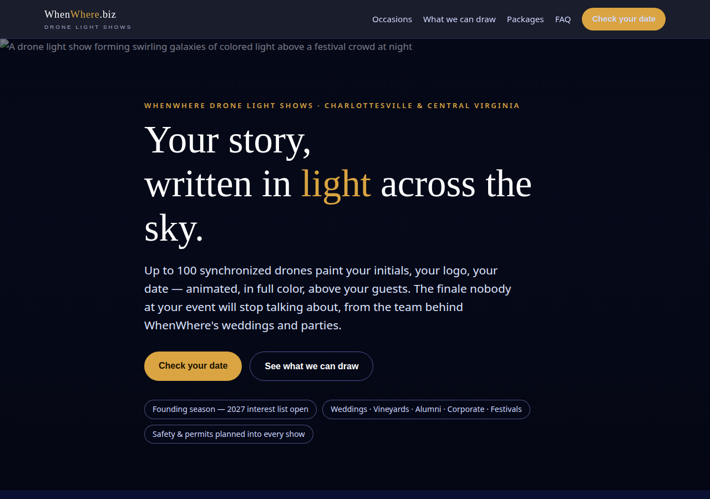
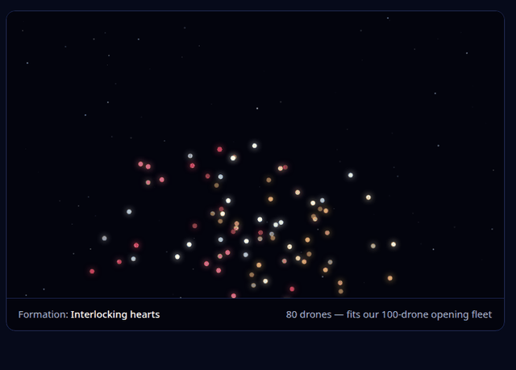
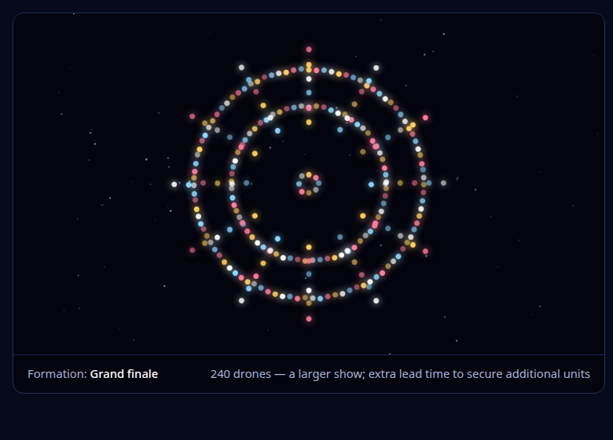

# WhenWhere Drone Light Shows



Custom drone light shows for weddings, vineyard celebrations, alumni
weekends, corporate events, and festivals across Charlottesville and
Central Virginia. Visitors register interest for the 2027 founding season
through an inquiry form, and can preview formations in an interactive
Formation Studio that draws each design with the drone count it actually
needs.

**Live site (planned):** <https://enonymous1.github.io/whenwhere-drone-light-shows/>
— GitHub Pages, deployed from this repo (see [Deployment](#deployment)).

## Description

A single static page (`index.html`, ~67 KB, no framework, no build step
to view it) with:

- **Hero + six occasion cards** — weddings, vineyards & wineries,
  corporate, festivals, alumni, proposals & private estates.
- **Formation Studio** — an interactive canvas preview. Tap a design and
  the fleet assembles it: interlocking hearts, wedding rings, a wine
  glass, a starburst, a grand finale, or your own words (initials, a year,
  a short word). Every design is sized to the real fleet — see
  [Fleet sizing](#fleet-sizing).
- **Three packages** — The Moment, The Signature Show, Show + Party (with
  DJ & MC), plus how-it-works steps, a drones-vs-fireworks comparison, and
  an FAQ (FAA Part 107 licensed pilots, insured operations).
- **Inquiry form** — submits to a Google Form when one is connected (see
  [Connecting the Google Form](#connecting-the-google-form-inquiries)).
  Until then it runs in **demo mode**: submitting builds the inquiry to
  copy or download, and the page says so.



*The Formation Studio assembling the interlocking hearts — 80 drones,
two tones, woven over/under at each crossing.*

### Fleet sizing

Opening fleet is **100 drones**; larger shows need extra lead time to
secure additional units. The studio caption says so per design.

| Design | Drones | Note |
|---|---|---|
| Interlocking hearts | 80 | fits the opening fleet |
| Wedding rings | 100 | uses the full opening fleet |
| Wine glass | 60 | fits the opening fleet |
| Your words (initials / dates) | ~25 per character, 50–100 | fits the opening fleet |
| Starburst | 200 | larger show — extra lead time |
| Grand finale (twin rings + 12 radiating spikes) | 240 | larger show — extra lead time |

The hero says "Up to 100 synchronized drones", the packages carry fleet
lines (Moment: 50–100 drones; Signature: up to 100 per scene, 200+
finales with extra lead time), and the "How far ahead" FAQ notes that
200+ finales need the earliest possible word.





*Three formations as drawn in the studio: interlocking hearts (rose +
gold, woven), the grand finale (twin rings + 12 spikes, slowly rotating),
and your words (LOVE).*

## Prerequisites

To **view** the page you need nothing but a browser. To **rebuild** it
from the source, or run the tests, you need:

| Tool | Needed for | Version |
|---|---|---|
| Python 3 | Running the build script | 3.9+ |
| Pillow (`pip install Pillow`) | Extracting + resizing the photos in the build | any recent |
| Node.js | The build's JS syntax check (`node --check`) and the smoke test | 22+ |
| Chrome or Chromium | The smoke test and the assembly-GIF capture | any recent |

Node and Chrome are optional: without Node the build prints a warning
and skips the JS syntax check; without Chrome the smoke test cannot run.

## Installation

```bash
git clone https://github.com/enonymous1/whenwhere-drone-light-shows.git
cd whenwhere-drone-light-shows
pip install Pillow
```

There are no other dependencies — the page is plain HTML, CSS, and
JavaScript, and its only external requests are Google Fonts (Marcellus +
Jost) and, once connected, the Google Form.

## Local Development

### Preview

Open `index.html` in a browser, or serve the folder so relative paths
resolve exactly as they will on Pages:

```bash
python3 -m http.server 8000
# open http://localhost:8000
```

### Rebuilding the page — read this first

**`index.html` is generated output. Do not edit it by hand** — the next
build overwrites it. The source of truth is `tools/build.py`, which reads
the original page upload (`tools/source.html`), extracts its 7 inline
photos to `assets/`, and applies the review fixes as assertion-checked
string replacements. To change the page, edit the build script (or the
source) and rebuild:

```bash
python3 tools/build.py
# index.html written: ~68,000 chars
# node --check: OK
```

The build fails loudly (non-zero exit) if any replacement anchor is
missing, and it validates the result: it runs the built inline script
through `node --check` when Node is available and asserts the fleet
counts are present. Run it from any directory — paths resolve from the
script's own location.

> **Architecture note:** the generator and its input now live in this
> repo (`tools/`), so the repo is self-contained and the GitHub Actions
> workflow can rebuild the page on every push. The remaining structural
> step is making `index.html` itself the source of truth instead of a
> patch list over a frozen upload — see `REVIEW.md` §3.1.

### Tests

```bash
node tests/smoke.mjs            # loads the page in headless Chrome and
                                # asserts every formation's drone count,
                                # the button labels, and no JS errors
node --check tests/smoke.mjs    # syntax-check the test itself
```

The smoke test needs Chrome (set `CHROME_PATH` if it is not on the
usual paths). It runs against the built `index.html` in this folder, so
rebuild first if you changed the build script.

### Regenerating the screenshots and GIF

The images in `docs/screenshots/` are captured from the built page with
headless Chrome (see `tests/capture-assembly.mjs` for the GIF — it drives
the real browser over the DevTools Protocol because the animation is
`requestAnimationFrame`-driven and virtual time cannot fast-forward it):

```bash
node tests/capture-assembly.mjs heart /tmp/ww-gif/frames
python3 - <<'EOF'
from PIL import Image
import pathlib
frames = sorted(pathlib.Path('/tmp/ww-gif/frames').glob('frame-*.png'))
imgs = [Image.open(f).convert('RGB').resize((640, 459), Image.LANCZOS) for f in frames]
imgs[0].save('docs/screenshots/formation-assembly.gif', save_all=True,
             append_images=imgs[1:], duration=200, loop=0, optimize=True)
EOF
```

Settled-formation stills are plain headless screenshots with
`--force-prefers-reduced-motion` (which snaps the fleet to its final
positions), cropped to the stage.

### Configuration — the two things to set before launch

Everything launch-specific lives in one place, `WHENWHERE_CONFIG`, near
the top of the `<script>` in `index.html` (generated by the build script
from the config block it inserts):

```js
var WHENWHERE_CONFIG = {
  contactEmail: 'hello@whenwhere.biz', // TODO: confirm this is the right inbox
  googleForm: { formResponseUrl: '', entries: { /* entry.XXXXXXXX per field */ } }
};
```

- **Contact email** is the single source of truth: every `mailto:` link
  and visible address on the page is synced from it at load. Change it
  here and nowhere else.
- **Fleet counts** are the single source of truth in `FLEET` (in the
  studio script): the count tags on the formation buttons are filled
  from it at load, so the labels can never drift from the real counts.

## Deployment

Hosted on GitHub Pages via GitHub Actions — free, fast, versioned in
git, and no backend needed (the form posts straight to a Google Form).
The workflow (`.github/workflows/pages.yml`) rebuilds `index.html` from
source, runs the smoke test, and deploys the freshly built site on every
push to `main`. The live page is always current with the repo: you never
deploy by hand, and you never have to remember to rebuild before
pushing — the workflow does both.

**One-time setup:**

1. Upload this folder's contents (including `.github/` and `tools/`) to
   the root of a public repo, e.g. `enonymous1/whenwhere-drone-light-shows`.
2. Repo → **Settings → Pages → Build and deployment → Source: GitHub
   Actions** → Save. (Not "Deploy from a branch" — that would publish
   the committed file and skip the build.)
3. Push to `main`. Watch the run under the repo's **Actions** tab; it
   takes ~1–2 minutes. The live URL is
   `https://enonymous1.github.io/whenwhere-drone-light-shows/`.

**How it stays current:** any push to `main` — a copy change, a fleet
count, a new photo, a build-script fix — triggers a fresh build, the
smoke test, and a deploy. Pull requests run the build and the smoke test
but do not deploy, and fail if the committed `index.html` is stale
(rebuild locally and commit it). To redeploy without a code change:
**Actions → Deploy to GitHub Pages → Run workflow**.

When the full site is ready, move these files under
`whenwhere.biz/drone-light-shows/` — the canonical URL and `og:image` in
`index.html` already point there. Note they point at `whenwhere.biz`
today, so social cards will not resolve until the move (the page itself
works fine on Pages in the meantime).

## Connecting the Google Form (inquiries)

The page is wired for Google Forms but ships in **demo mode**: with no
form configured, submitting shows the inquiry to copy/download and says
so ("Demo mode: no form is connected yet…"). To go live:

1. Go to <https://forms.google.com> → Blank form → title
   **"WhenWhere Drone Light Shows — Inquiry"**.
2. Add these questions, all short-answer except where noted:
   1. Your name (required)
   2. Email (required)
   3. Phone
   4. Event type (multiple choice: Wedding / Vineyard / winery celebration /
      Corporate / brand event / Festival / community celebration /
      Alumni / university event / Proposal / Private party / birthday /
      Venue or planner — partnership / Something else)
   5. Event date (date question; add "Flexible / not sure yet" as the
      question description, or accept the text the page sends)
   6. Venue / town
   7. Expected guests (multiple choice: Under 50 / 50–150 / 150–300 /
      300–1,000 / Over 1,000)
   8. Rough budget for the show (multiple choice: Under $5,000 /
      $5,000–$10,000 / $10,000–$20,000 / Over $20,000)
   9. Package you're eyeing (multiple choice: The Moment /
      The Signature Show / Show + Party)
   10. What would you love to see in the sky? (paragraph)
   11. Where are you in planning? (multiple choice: Ready to book /
       Planning ahead / Just curious)
   12. Is this a surprise? (multiple choice: Yes / No)
3. **Responses tab → Link to Sheets** (optional, recommended) so every
   inquiry lands in a spreadsheet.
4. Get the entry IDs: **⋮ → Get pre-filled link**, fill any value in each
   question, generate the link, and copy the `entry.XXXXXXXX` value for
   each question from the URL.
5. In the build script, find `WHENWHERE_CONFIG.googleForm` and paste:
   - `formResponseUrl`: your form's URL with `/viewform` replaced by
     `/formResponse`, e.g.
     `https://docs.google.com/forms/d/e/XXXX/formResponse`
   - each `entries.<field>`: its `entry.XXXXXXXX`
6. Rebuild (`python3 tools/build.py`) and push to `main` — the workflow
   rebuilds, smoke-tests, and redeploys automatically — then submit a test
   inquiry from the live page. It should appear under the form's
   **Responses** tab within seconds. The page shows "Thank you" on success.

One honest limitation: the submission uses `fetch(..., { mode: 'no-cors' })`,
so the browser cannot see the response — a successful-looking "Thank you"
means the request was sent, not that Google accepted it. Verify with the
test inquiry in step 6; if the form URL or an entry ID is wrong, nothing
will arrive and the page will not know.

## Before launch checklist

- [ ] Confirm `hello@whenwhere.biz` is the inbox that should receive
      inquiries — change it in `WHENWHERE_CONFIG.contactEmail` only.
- [ ] Connect the Google Form (above) and test one live submission.
- [ ] Check the canonical / `og:image` URLs still point at the final home
      once the page moves to `whenwhere.biz` (they already say
      `whenwhere.biz/drone-light-shows/`).
- [ ] Swap the illustrative photos for real founding-season show photos
      when you have them (the honest disclaimer line under the occasion
      cards stays until then).
- [ ] Add analytics if you want to measure which package or occasion
      drives inquiries.

## Project structure

```text
whenwhere-drone-light-shows/
├── .github/
│   └── workflows/
│       └── pages.yml           # build + smoke test + deploy on push to main
├── index.html                  # the page (GENERATED — see Local Development)
├── tools/
│   ├── build.py                # the generator (source of truth for index.html)
│   └── source.html             # the original page upload the generator reads
├── assets/                     # photos (hero + 6 occasion cards, optimized JPEG)
│   ├── hero.jpg                # hero (1248×832, 161 KB)
│   └── weddings.jpg … proposals.jpg   # occasion cards (900 px wide, ~30–104 KB)
├── docs/
│   └── screenshots/            # hero, formation stills, assembly GIF (for this README)
├── tests/
│   ├── smoke.mjs               # CDP smoke test: formation counts, labels, JS errors
│   └── capture-assembly.mjs    # CDP frame capture for the assembly GIF
├── README.md
├── REVIEW.md                   # staff review: findings, fixes, recommendations
└── LICENSE                     # © 2026 WhenWhere.biz, all rights reserved
```

## License

© 2026 WhenWhere.biz — All rights reserved. See `LICENSE`.
