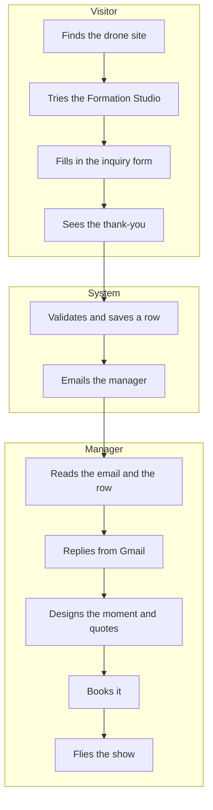
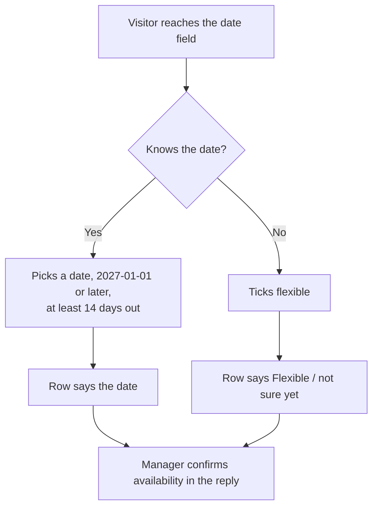
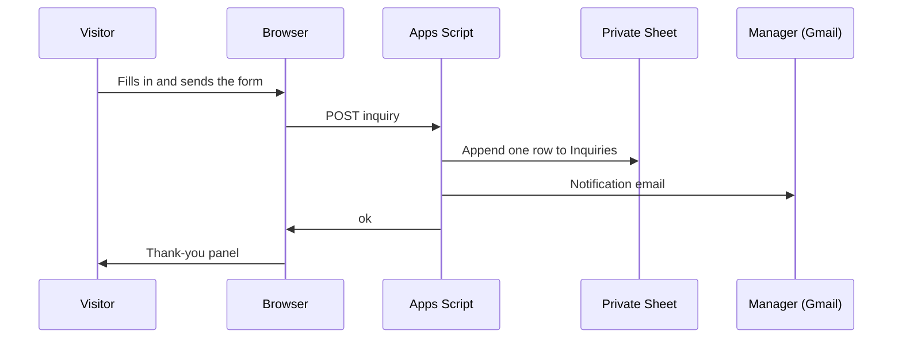

# When&Where Drone Light Shows — Inquiry Pipeline & Workflow

**What this is:** the journey of one drone-show inquiry, from a visitor
finding the page to the show flying, told from both sides — what the
**visitor** sees and does, and what the **manager** (Justin) sees and does.

**Scope:** the drone site only (weddings, vineyard celebrations, alumni
weekends, corporate events, festivals, proposals — any event that wants
a drone light show in the 2027 founding season). The main site has its
own pipeline doc at `whenwhere-biz-main-site/docs/INQUIRY-PIPELINE.md`.

**What it is not:** a setup guide. The form backend and its redeploy steps
are in the README's form-setup section. This document assumes that setup is
done and describes the pipeline as it runs day to day.

> The diagrams below are Mermaid. They render as charts on GitHub; in a
> plain text editor they read as the code blocks they are.

---

## The pipeline at a glance

---

## Stage 0 — Setup (manager only, one time)

Before any of this works, the manager has already done the following
(once). The visitor never sees any of it.

| Manager does | Where |
|---|---|
| Creates the **private bookings Sheet** for the drone site. Never published to web, shared only with people who should see client details. | Google Sheets |
| Pastes `apps-script/Code.gs` into the private Sheet's Apps Script editor, sets `NOTIFY_EMAIL` to his personal Gmail, and deploys it as a web app (Execute as: Me, Who has access: Anyone). | Apps Script |
| Puts the web app URL in the site as `INQUIRY_ENDPOINT`. | `config.js` |
| Adds his own tabs alongside `Inquiries` in the private Sheet (e.g. `Bookings`, `Payments`). The script only ever touches `Inquiries`, so their headers are his to type. | Private Sheet |

Note: the drone site has **no public calendar of its own**. Availability is
confirmed by the manager in the reply (Stage 3). When a drone show books,
the manager marks the date in the **main site's** public availability Sheet
(see Stage 5), so the main site's calendar stops offering it.

---

## Stage 1 — Discover: "What would my moment look like?"

### Visitor

- Lands on the drone site, reads the occasions (weddings, vineyard
  celebrations, alumni weekends, corporate events, festivals,
  proposals), looks at the formation photos.
- Opens the **Formation Studio** and types their own word — their
  initials, a date, "MARRY ME" — and watches the drones draw it in
  the sky, with the drone count the design actually needs.
- Tries the shapes: interlocking hearts, wedding rings, the champagne
  toast, the starburst, the grand finale.
- The studio is the pitch: the visitor sees their own moment before
  spending anything, and carries that exact design into the inquiry.
- When they're ready, they go to the inquiry form. There is no public
  calendar to check first — the date question is answered by the
  manager, not by a grid.

### Manager

- Keeps the studio and the photos honest: the formations shown are the
  ones the fleet can actually fly, at the drone counts shown.
- No calendar to keep current on this site — but the main site's public
  availability Sheet is the shared source of truth for dates (see
  Stage 5).

### What the system does

- The studio draws the visitor's word and the shapes with the real
  geometry, at the real drone counts (opening fleet 100; larger shows
  need extra lead time to secure additional units).

---

## Stage 2 — Inquire: the form

### Visitor

- Fills in the form. Required fields are name, email, and event type;
  the date is required unless they tick "My date is flexible / not
  sure yet".
- **Fields:** name, email, phone, event type, event date, venue/town,
  expected guests, rough budget for the show, the package they're
  eyeing, "What would you love to see in the sky?", where they are in
  planning, and a "This is a surprise" checkbox.
- **Event types:** Wedding, Vineyard / winery celebration, Corporate /
  brand event, Festival / community celebration, Alumni / university
  event, Proposal, Private party / birthday, Venue or planner —
  partnership, Something else.
- **Packages:** The Moment, The Signature Show, Show + Party.
- **Date rules the visitor feels:** the earliest date is **2027-01-01**,
  and at least **14 days out** — drone shows are a 2027 founding season.
  Ticking "flexible" skips the date entirely.
- Hits **Send my inquiry**. If something required is missing, the form
  flags that field and nothing is sent.
- Sees a **thank-you panel**: "Thank you, {first name} ✦".
- **Gets a confirmation email** ("Thanks — your drone light show inquiry is in"), styled like the notification, repeating their details and promising a personal reply usually within two working days. It is a receipt, not a mailing list — nothing else is coming unless they ask. If the send itself fails, the form shows the inquiry text with copy/download buttons so they can send it another way.
- If they submit the same inquiry twice within 5 minutes (same email +
  same date), the second copy is silently dropped — no second row, no
  second email — but the form still shows the thank-you. A different
  date, or waiting 5 minutes, goes through.

### The date path

### What the system does (automatic)

1. Validates the fields in the browser — including the date floor
   (2027-01-01, 14 days out) unless the flexible box is ticked.
2. POSTs the inquiry to the Apps Script endpoint.
3. The script appends one row to the private Sheet's `Inquiries` tab —
   13 columns: `Submitted Date | Name | Email | Phone | Event Type |
   Event Date | Venue/Town | Expected guests | Budget Estimate |
   Package | Stage | isSurprise | Would love to see`.
4. The script writes the header row itself, once, when the tab is
   empty. If the tab already has rows with no headers, the manager
   inserts the header row by hand (right-click row 1 → Insert 1 row
   above).
5. The script emails the manager a notification (see Stage 3).
6. The script answers `ok`, and the form shows the thank-you. Unlike
   the main site, this form reads the reply body — the thank-you only
   appears when the server actually answered `ok`.

### Manager

- Does nothing at this stage — the row and the email arrive on their
  own. (Unless the visitor calls or messages separately, which is
  outside this pipeline.)

---

## Stage 3 — Respond: the manager's inbox

### Manager

- Gets a **notification email** at his personal Gmail for every
  inquiry. Subject: `New drone light show inquiry — {type}`.
- The email lists every field the visitor entered, and ends with a
  **"View all inquiries in the private Sheet"** link that opens the
  spreadsheet at the `Inquiries` tab — one click shows the full history
  around the row that just landed.
- Opens the Sheet (or clicks the link in the email) and reads the row.
  Two fields matter most here: **Package** (which show they're eyeing)
  and **isSurprise** (whether every conversation must stay discreet).
- **Replies from his personal Gmail** — the same address the
  notification came to — using the same signature every time. The
  stated aim is a reply within two working days.
- Confirms the date is available (there is no public calendar on this
  site, so this is the moment availability is decided), or proposes
  nearby dates if the visitor was flexible.
- If it is a surprise proposal, the reply stays discreet — no mention
  of the surprise in any subject line or shared thread.

### Visitor

- Gets the confirmation email straight away, then waits for the
  manager's personal reply — the two-working-day reply is still the
  moment the pipeline feels alive to them, but the confirmation is the
  proof the inquiry landed.
- Replies with the details the manager asked for.

### What the system does

- Nothing beyond the notification email. There is no auto-reply, no
  read receipt, and no reminder if the manager hasn't answered yet.

---

## Stage 4 — Design the moment & quote

### Visitor

- Trades messages with the manager: pins down the date, the venue, the
  package, the guest count, and — the part only this site has — what
  they want to see in the sky.
- The design they played with in the studio is the starting point: the
  word, the shapes, the moment order.
- Gets a price / package proposal and decides.

### Manager

- Confirms what the fleet can actually draw at the date and the venue
  (100-drone opening fleet; larger shows need extra lead time to
  secure additional units).
- Confirms the package and the price, and records the working details
  in the private Sheet (his own `Bookings` tab, or notes against the
  inquiry row — whichever he chooses; the script doesn't do this part).
- If the visitor goes quiet, the follow-up is his to send. Nothing
  chases them automatically.

### What the system does

- Nothing. This stage is entirely people talking to people — the studio
  already did its part in Stage 1.

---

## Stage 5 — Book

### Visitor

- Confirms the date, the package, and the price.
- Pays whatever deposit / payment the manager asks for (how payment is
  taken is outside this pipeline — see "Gaps & decisions").

### Manager

- Records the booking in the private Sheet — the `Bookings` tab with
  client name, venue, package, price, and payment status — and the
  payment in the `Payments` tab.
- **Marks the date in the main site's public availability Sheet**
  (`Status` → `Booked`), so the main site's calendar stops offering
  it. Reloads the main site to check. (The drone site has no public
  calendar of its own, so this is the step that blocks the date
  publicly.)
- Confirms back to the visitor from personal Gmail: date, package,
  price, what's next.

### What the system does

- Nothing. The date is only blocked because the manager edited the
  main site's public Sheet.

---

## Stage 6 — Fly the show & close out

### Visitor

- The show flies — their word, their shapes, their moment in the sky.
- Afterwards, the manager may ask for feedback, photos, or a recording.

### Manager

- Flies the show.
- Marks the booking done in the private Sheet (`Bookings` / `Payments`
  tabs), so the history is complete.
- Keeps any photos, feedback, or recordings the visitor shares for the
  site's gallery (with their permission) — real show material replaces
  the illustrative photos over time.

---

## What is automatic, and what is manual

| Step | Automatic | Manual (manager) |
|---|---|---|
| Studio draws the visitor's word/shapes | Real geometry, real drone counts | Keeping the studio honest to what the fleet can fly |
| Form validation + spam guard | Browser + script (5-min same email+date, date floor 2027-01-01 + 14 days) | — |
| Row saved to `Inquiries` | Script appends it + writes the header once | Inserting the header by hand if the tab already had rows |
| Manager notified | Email to `NOTIFY_EMAIL` on every submit, with a link to the Sheet | Reading it and replying |
| Visitor confirmed | Thank-you panel (shown only when the server answered `ok`) + confirmation email to the visitor | — |
| Reply to the visitor | — | From personal Gmail, same signature, ~2 working days; discreet if a surprise |
| Availability confirmed | — | Manager confirms it in the reply (no public calendar on this site) |
| Record the booking + payment | — | `Bookings` / `Payments` tabs in the private Sheet |
| Block the date publicly | — | Edit `Status` in the **main site's** public Sheet |
| Follow-up if the visitor goes quiet | — | Manager sends it |
| Close out after the show | — | Mark done in the private Sheet |

---

## The manager's routine

**When a notification email arrives:**
1. Read the email (or click its Sheet link).
2. Read the row in the `Inquiries` tab — check **Package** and
   **isSurprise** first.
3. Reply from personal Gmail — same signature, within two working days,
   discreet if it's a surprise. Confirm the date or propose nearby ones.

**When a booking is confirmed:**
1. Add the booking to the private Sheet's `Bookings` tab; record payment in `Payments`.
2. Set the date to **Booked** in the main site's public availability Sheet. Reload the main site to check.
3. Confirm back to the visitor.

**Weekly (or when the inbox looks stale):**
1. Skim the `Inquiries` tab for anything unanswered.
2. Check the main site's public Sheet against the private Sheet's bookings — they should agree.

---

## Gaps & decisions (what the pipeline does not do yet)

These are things the system does **not** do today. Each is a decision,
not a bug — but they are the places where the pipeline leans on the
manager's memory.

1. **No pipeline status column.** The `Inquiries` tab records what the
   visitor submitted — including the stage *they* picked (Ready to
   book / Planning ahead / Just curious). It does not track the
   manager's stage (contacted → quoted → booked → flown). Tracking that
   means adding a column to `Inquiries` (e.g. `Status`) or running it
   through the `Bookings` tab.
2. **One notification address.** `NOTIFY_EMAIL` is a single personal
   Gmail. A second recipient (e.g. James) would mean a second address
   in the script.
3. **No automated follow-up or reminder.** If the manager hasn't
   replied, or a visitor goes quiet after a quote, nothing nudges
   anyone.
4. **No payment step in the pipeline.** The private Sheet has a
   `Payments` tab to record payments, but how a deposit is taken
   (link, invoice, bank transfer) is not part of the system.
5. **No public calendar on this site.** Availability is confirmed by
   the manager in the reply, and the date is blocked by editing the
   **main site's** public Sheet. Nothing warns the manager if a booked
   drone date is still showing Available on the main site.
6. **Drone shows are 2027-only for now.** The form won't accept a date
   before 2027-01-01, and requires at least 14 days' lead.

---

## One-page summary

| Stage | Visitor | System (automatic) | Manager |
|---|---|---|---|
| Discover | Browses, tries their word in the studio | Studio draws it with real counts | Keeps the studio honest |
| Inquire | Fills + sends the form | Validates, saves a row, emails the manager | — |
| Respond | Waits | — | Reads the email/row, replies from Gmail (~2 days), confirms the date |
| Design + quote | Shares the moment, picks a package | — | Confirms what the fleet can draw, quotes |
| Book | Confirms, pays | — | Records booking + payment; marks the date Booked on the main site |
| Fly | The show flies | — | Flies it, closes it out in the private Sheet |
