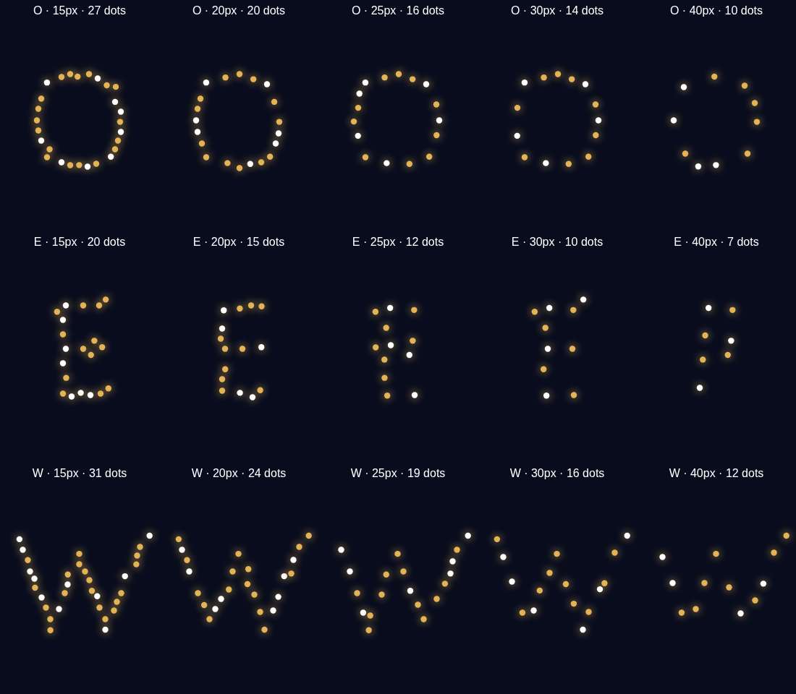
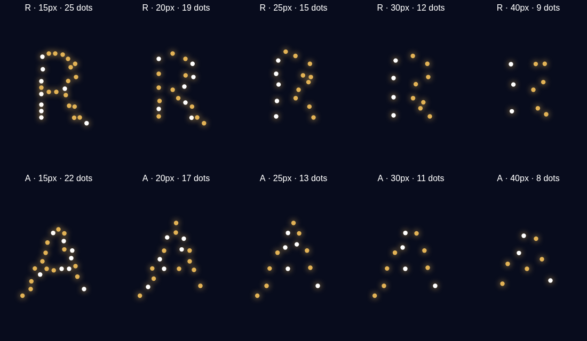
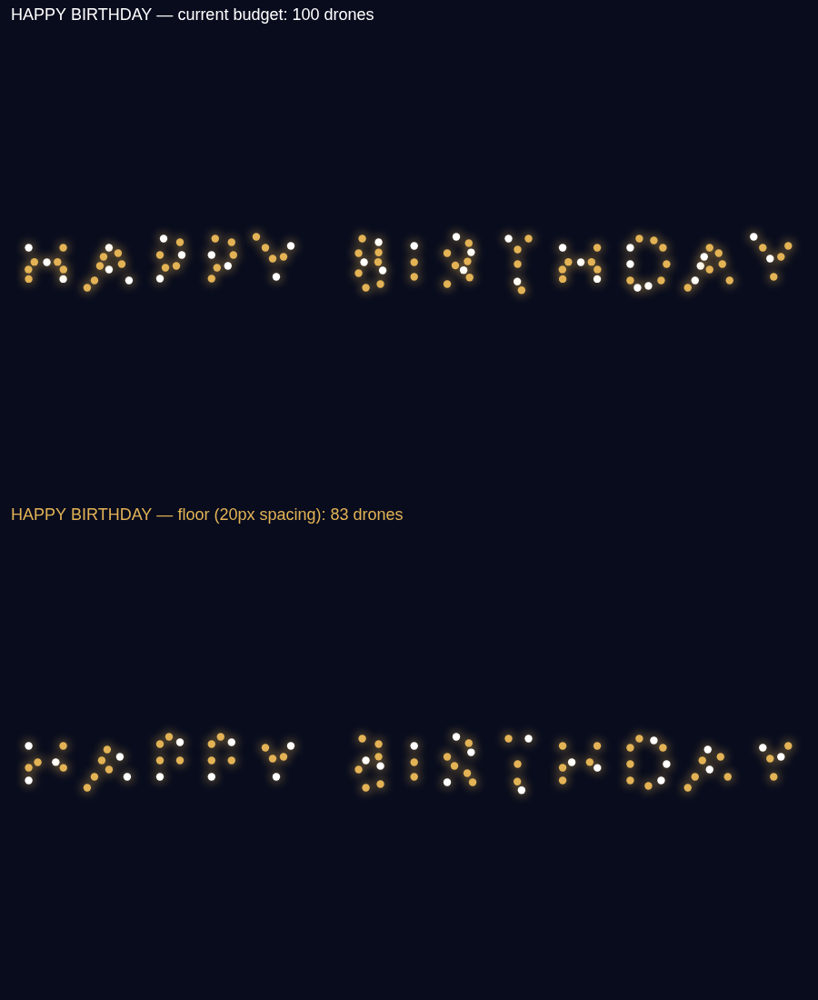

# Word readability floor

**Question:** how few drones can a letter get before it stops reading? The
page only assigns a *budget* (`max(50, min(100, glyphs × 25))` dots per word)
— this file records the *need*, measured 2026-11-20 on the v1.4.7 build
(Marcellus, 2px sampling).

## The floor: 25px spacing

Five test letters (O, E, W, R, A) were rendered at 15 / 20 / 25 / 30 / 40px
spacing and judged by eye. The method: a probe copy of the repo that stashed
the per-glyph skeletons from `wordPoints` pass 1, so any glyph could be
thinned to any count with the real `thinUniform` + `separatePoints` (10.5px
min gap).

- **15px — dense.** Solid strokes, no ambiguity. What short words get.
- **20px — solid.** Comfortable; every letter reads cleanly.
- **25px — the floor.** Every test letter still reads. This is the minimum.
- **30px — fragile.** Short features start to fail: E's middle bar thins to
  2 dots, A's crossbar to 2, R's bowl to 4–5. Readable, but one dot lost and
  the feature is gone.
- **40px — broken.** A's crossbar is gone (reads as Λ, not A), E's bars are
  2 dots each, R's bowl is 3 dots. The letter no longer reads on its own.

## Per-letter floor (190px Marcellus)

Stroke = skeleton length in canvas px. Floor = dots needed at 25px spacing
(reads); solid = dots at 20px spacing (comfortable). A glyph's floor scales
with its rendered size — these numbers are at 190px; at a word's fitted
size the stroke is shorter, so the floor count is lower in the same
proportion.

| Ch | Stroke | Floor (25px) | Solid (20px) | Ch | Stroke | Floor (25px) | Solid (20px) |
|----|--------|--------------|--------------|----|--------|--------------|--------------|
| A | 330 | 13 | 17 | N | 396 | 16 | 20 |
| B | 408 | 16 | 20 | O | 408 | 16 | 20 |
| C | 300 | 12 | 15 | P | 280 | 11 | 14 |
| D | 392 | 16 | 20 | Q | 498 | 20 | 25 |
| E | 298 | 12 | 15 | R | 372 | 15 | 19 |
| F | 224 | 9 | 11 | S | 238 | 10 | 12 |
| G | 338 | 14 | 17 | T | 236 | 9 | 12 |
| H | 336 | 13 | 17 | U | 314 | 13 | 16 |
| I | 116 | 5 | 6 | V | 262 | 10 | 13 |
| J | 172 | 7 | 9 | W | 470 | 19 | 24 |
| K | 368 | 15 | 18 | X | 404 | 16 | 20 |
| L | 184 | 7 | 9 | Y | 254 | 10 | 13 |
| M | 486 | 19 | 24 | Z | 358 | 14 | 18 |
| 0 | 406 | 16 | 20 | 5 | 276 | 11 | 14 |
| 1 | 162 | 6 | 8 | 6 | 362 | 14 | 18 |
| 2 | 292 | 12 | 15 | 7 | 212 | 8 | 11 |
| 3 | 292 | 12 | 15 | 8 | 402 | 16 | 20 |
| 4 | 296 | 12 | 15 | 9 | 364 | 15 | 18 |

Cheapest letter: I (5 at the floor). Most expensive: Q (20), M and W (19).

## Word level: the budget covers the floor, not the dense level

| Word | Type size | Budget | Floor (25px) | Solid (20px) | Dense (15px) | Margin over floor |
|------|-----------|--------|--------------|--------------|--------------|-------------------|
| LOVE | 190px | 100 | 45 | 57 | 76 | 2.2× |
| 2027 | 190px | 100 | 48 | 61 | 79 | 2.1× |
| MARRY ME | 130px | 100 | 72 | 89 | 119 | 1.4× |
| WEDDINGS | 134px | 100 | 73 | 91 | 122 | 1.4× |
| HAPPY BIRTHDAY | 82px | 100 | 68 | 83 | 108 | 1.5× |
| CONGRATULATIONS | 71px | 100 | 68 | 87 | 112 | 1.5× |

- **Every probed word clears the floor** — and no per-glyph share ever fell
  below its 20px-solid floor in the probed words (the tightest is the I in
  HAPPY BIRTHDAY / CONGRATULATIONS: 3 dots vs a floor of 2–3).
- **The margin shrinks with word length:** 2.2× for LOVE, ~1.4× for anything
  7+ glyphs. Long words sit just above the floor, not comfortably above it.
- **The dense level (15px) is unaffordable for every word over 4 glyphs**
  at the 100-drone budget. Only short words can look as solid as LOVE.
  Buying the dense level for long words is what the unpicked 200-drone
  lever would do (MARRY ME at 175 was probed earlier — it clears the 119
  dense floor).

## The relative-spacing caveat

The floor is in absolute px, but the eye sees spacing *relative to glyph
size*. Long words shrink the type (190 → 82px for HAPPY BIRTHDAY), so the
same absolute spacing is relatively sparser — that is why HAPPY BIRTHDAY
reads dotted at the current budget even though its shares clear the floor.
The comparison below shows it: 100 drones reads, 83 (the 20px floor) also
reads but thinner — word context carries the shortfall, each letter only
needs to be distinguishable, not beautiful.

## Open follow-ups (unpicked)

1. Enforce a per-glyph minimum in `allocateCounts` — never allocate fewer
   dots than the 25px floor for that glyph at its rendered size. Not a fix
   for a live failure (no probed word goes below it), a guarantee for edge
   cases (a word mixing a Q with many I's could starve an I today).
2. The 200-drone lever: the only way long words reach the dense level.
